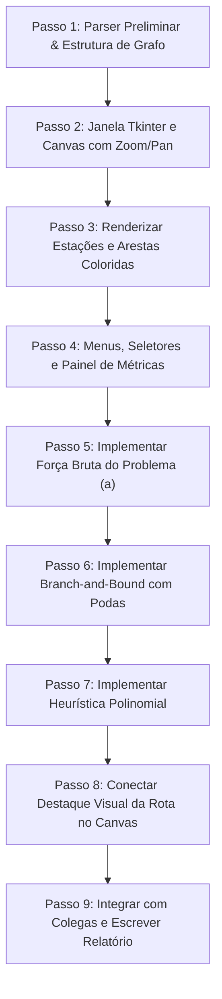

# Planejamento & Guia de Desenvolvimento — Integrante 1
**Trabalho Prático: Metrô de Paris (Grafos, Busca Exaustiva, Branch-and-Bound e Heurísticas)**  
**Disciplina:** Projeto e Análise de Algoritmos (PAA) — ICEI / PUC Minas  
**Professor:** Alexei Machado  
**Linguagem & Framework:** Python 3 (Apenas bibliotecas nativas: `tkinter`, `math`, `time`, `collections`, etc.)  

---

## 1. Seu Papel no Grupo (Foco: GUI + Problema a)

Como **Integrante 1**, sua responsabilidade central é dupla:
1. **Infraestrutura Visual (GUI):** Construir a interface gráfica completa em Tkinter que carrega os arquivos do metrô, renderiza as estações e conexões, e oferece menus para disparar e visualizar os 9 algoritmos do trabalho (3 problemas $\times$ 3 abordagens).
2. **Problema Teórico (a) — Maior Ciclo Simples (*Longest Simple Cycle*):** Implementar e dominar as 3 abordagens de resolução (Força Bruta, Branch-and-Bound e Heurística Polinomial), além de redigir a seção correspondente no relatório SBC.

---

## 2. Requisitos Críticos do Edital

* **Arquivo de Código Único:** Toda a aplicação (interface gráfica, parsers, classes de grafo e os algoritmos dos 3 problemas) deve rodar em um único arquivo `.py` na entrega final (ex.: `Gnn.py` ou `main.py`).
* **Apenas Bibliotecas Padrão do Python:** Não use `networkx`, `matplotlib`, `pygame` ou qualquer pacote via `pip`. Toda a renderização deve ser feita com o `tk.Canvas` nativo para garantir execução imediata nos computadores do laboratório da PUC Minas.
* **Avaliação Oral Individual:** Na apresentação, o professor fará perguntas específicas e pode pedir modificações no código ao vivo. Você deve entender em profundidade as podas do B&B, o critério guloso da heurística e como a GUI interage com os algoritmos.

---

## 3. Especificação da Interface Gráfica (Tkinter)

A interface gráfica é a "vitrine" do trabalho e serve de base para os 3 integrantes.

### 3.1. Requisitos de Visualização e Renderização
* **Leitura dos Arquivos de Entrada:**
  * **Arquivo de Estações:** Linhas no formato `Nome x y`.
  * **Arquivo de Linhas:** Seções no formato `LinhaX cor N` seguido dos pares `Estacao1 Estacao2`.
* **Renderização no `tk.Canvas`:**
  * **Vértices (Estações):** Círculos nas posições $(x, y)$ lidas, acompanhados pelo nome da estação.
  * **Arestas (Trechos):** Linhas conectando as estações, desenhadas na cor indicada no arquivo da linha.
  * **Tratamento de Coordenadas:** Suporte a *offset* e escala (auto-ajuste para caber na tela) e/ou *scroll/zoom*.

### 3.2. Controles e Menus
* **Barra de Controle / Menu Superior:**
  * Botões para carregar o arquivo de coordenadas e o arquivo de linhas.
  * Seletor de Problema:
    * **Problema (a):** Maior Ciclo Simples
    * **Problema (b):** Conjunto Dominante Mínimo (Guichês)
    * **Problema (c):** Coloração de Vértices (Manutenção)
  * Seletor de Abordagem:
    * **Força Bruta**
    * **Branch-and-Bound**
    * **Heurística Polinomial**
  * Campo de Seleção da Estação Inicial (obrigatório para o Problema a — por dropdown ou clique no mapa).
  * Botão **"Executar Algoritmo"** e Botão **"Limpar Destaques"**.

### 3.3. Painel de Resultados & Feedback Visual
* **Painel Lateral de Métricas:**
  * Exibição do tempo de processamento medido com precisão (`time.perf_counter()`).
  * Métrica obtida: número de estações visitadas (Problema a), número de guichês (Problema b) ou número cromático $\chi(G)$ (Problema c).
  * Sequência de visita / lista de estações do resultado.
* **Destaque no Mapa:**
  * **Problema (a):** Destacar o ciclo desenhando a rota com arestas mais grossas e cor de destaque (ex.: amarelo/ouro brilhante), numerando a ordem de visita das estações.
  * **Problema (b):** Destacar os vértices escolhidos para guichê (marcador especial/halo).
  * **Problema (c):** Colorir os círculos das estações com as cores da partição calculada.

---

## 4. O Problema (a): Maior Ciclo Simples (*Longest Simple Cycle*)

### 4.1. Definição do Problema
* **Objetivo:** Determinar o número máximo de estações que um turista pode visitar com um só passe, **partindo e retornando a uma estação determinada $s$**, sem passar duas vezes pela mesma estação intermediária.
* **Classificação Teórica:** Maior Ciclo Simples em grafo não-ponderado não-direcionado (problema NP-Difícil, generalização do Ciclo Hamiltoniano).
* **Condição de Validade:** Um ciclo simples requer pelo menos 3 vértices ($s \to v_1 \to v_2 \dots \to s$), evitando apenas o retorno imediato pela mesma aresta ($s \to v \to s$).

---

### 4.2. Algoritmo 1: Força Bruta (DFS Exaustivo)
* **Conceito:** Exploração completa do espaço de estados através de uma busca em profundidade com backtracking.
* **Mecanismo:**
  1. Inicia em $s$ com `caminho = [s]` e `visitados = {s}`.
  2. Para cada vizinho $u$ do nó atual:
     * Se $u == s$ e `len(caminho) >= 3`: encontrou um ciclo simples válido. Compara com o `melhor_ciclo` e atualiza se `len(caminho) > len(melhor_ciclo)`.
     * Se $u \notin visitados$: marca $u$ como visitado, adiciona ao caminho e chama recursivamente.
     * Ao desempilhar, desmarca $u$ (backtracking).
* **Complexidade:** $O(|V|!)$ no pior caso.

---

### 4.3. Algoritmo 2: Branch-and-Bound (Poda por Limitante Superior)
* **Objetivo:** Obter exatamente a solução ótima (mesmo resultado da Força Bruta), porém podando ramos que comprovadamente não conseguem superar o melhor ciclo já encontrado.
* **Podas Essenciais (Upper Bound & Conectividade):**
  1. **Poda por Tamanho Máximo Teórico (Upper Bound):**
     * Seja $c$ o caminho atual de tamanho $k$.
     * Os vértices candidatos que ainda podem ser adicionados são os nós ainda não visitados pertencentes à componente conexa que alcança $s$.
     * Se $k + |Alcançáveis(não\_visitados)| \le len(melhor\_ciclo)$, **poda imediata**.
  2. **Poda por Perda de Retorno (Caminho de Volta):**
     * Se o nó atual não consegue mais atingir o nó inicial $s$ utilizando apenas nós não visitados (ou se $s$ não tem vizinhos livres/não visitados suficientes para fechar o ciclo), o ramo está morto: **podar imediatamente**.
  3. **Ordenação Gulosa de Ramificação (Branching Heuristic):**
     * Na escolha do próximo vizinho para expandir, ordenar os vizinhos pelo grau residual (ou conectividade com $s$) de forma decrescente.
     * Isso faz o B&B encontrar ciclos longos logo no início da busca, elevando rapidamente a linha de corte e aumentando drasticamente o número de podas.

---

### 4.4. Algoritmo 3: Heurística Polinomial (Aproximada)
* **Objetivo:** Encontrar um ciclo simples o mais longo possível em **tempo polinomial estrito** ($O(|V| \cdot |E|)$ ou $O(|V|^2)$), ideal para grafos grandes onde a busca exaustiva se torna inviável.
* **Estratégia Recomendada (DFS Guloso com Garantia de Retorno):**
  1. Começa em $s$.
  2. A cada passo, para escolher o próximo nó $u$ entre os vizinhos não visitados:
     * Filtra apenas os vizinhos que **mantêm um caminho de retorno até $s$** no subgrafo induzido pelos nós restantes (checagem BFS/DFS em $O(V + E)$).
     * Entre os viáveis, seleciona o vizinho com maior grau ou maior distância do nó de retorno para prolongar a exploração.
  3. Quando não for mais possível avançar sem perder a rota de volta, fecha o ciclo retornando diretamente para $s$.
  4. (Opcional) Refinamento local com 2-opt ou busca por inserção de vértices livres no ciclo.
* **Garantia:** Executa em frações de segundo mesmo com todas as linhas do metrô carregadas.

---

## 5. Interface de Integração com os Integrantes 2 e 3

Para manter a modularidade antes de unificar no arquivo final:
* O Integrante 2 fornecerá o parser dos dados e a classe `Grafo` (com listas de adjacência, estações e linhas).
* Os Integrantes 2 e 3 fornecerão funções padronizadas para você plugar nos botões da GUI:
  ```python
  # Assinaturas padronizadas esperadas:
  def resolver_problema_a(grafo, estacao_origem, metodo):
      # Implementado por você (Integrante 1)
      # metodo: 'forca_bruta' | 'branch_and_bound' | 'heuristica'
      # Retorno: (lista_estacoes_ciclo, tempo_execucao, nos_visitados)
      pass

  def resolver_problema_b(grafo, metodo):
      # Implementado pelo Integrante 2
      # Retorno: (conjunto_guiches, tempo_execucao)
      pass

  def resolver_problema_c(grafo, metodo):
      # Implementado pelo Integrante 3
      # Retorno: (dicionario_estacao_para_cor, tempo_execucao, num_cores)
      pass
  ```

---

## 6. Roteiro de Ação Prática (Passo a Passo)



1. **Passo 1:** Criar um parser preliminar para carregar dados de exemplo (ou arquivos reais) e uma estrutura leve de Grafo para poder desenvolver a GUI de imediato.
2. **Passo 2:** Criar a janela base `tkinter.Tk`, com um `Canvas` responsivo capaz de desenhar círculos, texto e linhas.
3. **Passo 3:** Adicionar lógica de normalização das coordenadas $(x, y)$ para que o mapa caiba perfeitamente no Canvas com margem agradável.
4. **Passo 4:** Criar a barra de ferramentas com botões para alternar algoritmos, dropdown para escolher estação de origem e labels para exibir os resultados.
5. **Passo 5:** Implementar o DFS exaustivo com backtracking para o Maior Ciclo.
6. **Passo 6:** Implementar a lógica de B&B com poda de alcance e poda de corte de tamanho.
7. **Passo 7:** Implementar a Heurística gulosa polinomial.
8. **Passo 8:** Implementar a função de desenho que "ilumina" o ciclo na tela e anima a rota.
9. **Passo 9:** Deixar o código estruturado para plugar as funções dos outros integrantes e documentar para o relatório SBC.


# Seção do Integrante 1 — Relatório Técnico & Planejamento Restante
**Trabalho Prático: O Metrô de Paris — Grafos, Busca Exaustiva, Branch-and-Bound e Heurísticas**  
**Disciplina:** Projeto e Análise de Algoritmos (PAA) — PUC Minas / ICEI  
**Professor:** Alexei Machado  
**Aluno:** Integrante 1 (Interface Gráfica & Problema a: Maior Ciclo Simples)  

---

## 📌 Checklist: O Que Falta Fazer (Aguardando os Colegas)

Quando os Integrantes 2 e 3 finalizarem as suas partes, você precisará apenas executar as seguintes tarefas finais:

- [ ] **1. Plugar o Retorno Visual do Problema (b) — Guichês (Integrante 2):**
  - O Integrante 2 fornecerá a função `resolver_problema_b(grafo, metodo)` retornando a lista/conjunto de estações escolhidas para guichê.
  - Atualizar a função de desenho do mapa para circular/destacar em verde/azul no Canvas essas estações.
- [ ] **2. Plugar o Retorno Visual do Problema (c) — Coloração de Vértices (Integrante 3):**
  - O Integrante 3 fornecerá a função `resolver_problema_c(grafo, metodo)` retornando um dicionário `{estacao: id_cor}`.
  - Atualizar o desenho das estações para preencher os círculos com as respectivas cores calculadas.
- [ ] **3. Rodar os Benchmarks do Grupo:**
  - Após o Integrante 2 gerar os arquivos oficiais das linhas sorteadas pelo critério $N = (\sum \text{matrículas}) \pmod 5$, rodar os 3 algoritmos do Problema (a) para 2, 4, 6, 8 e todas as linhas, coletando os tempos em milissegundos e número de nós/podas para preencher as tabelas do relatório.
- [ ] **4. Transpor o Texto Abaixo para o Template SBC Oficial:**
  - Copiar e colar a seção de texto acadêmico abaixo (já formatada e com pseudocódigos) no modelo LaTeX/Overleaf ou Word da SBC gerenciado pelo Integrante 3.

---

# 📝 TEXTO PRONTO PARA O RELATÓRIO TÉCNICO (PADRÃO SBC)
*(Copie o conteúdo das seções abaixo diretamente para o relatório final do grupo)*

---

## 1. Arquitetura e Implementação da Interface Gráfica (GUI)

A interface gráfica foi concebida para atender rigorosamente à exigência de portabilidade e ausência de dependências externas nos laboratórios da PUC Minas, utilizando exclusivamente os componentes nativos da biblioteca `tkinter` do Python 3.

### 1.1. Modelagem do Espaço Visual e Autoescala Dinâmica
O mapa do Metrô de Paris é renderizado sobre um componente `tk.Canvas`. Dado que as coordenadas cartesianas $(x_i, y_i)$ das estações fornecidas pelo arquivo de entrada possuem amplitudes arbitrárias, foi desenvolvido um algoritmo de projeção linear que mapeia as coordenadas do grafo para o sistema de coordenadas da janela em tempo real, preservando a proporção de aspecto (razão 1:1) para evitar distorções no plano:

$$\text{escala} = \min\left( \frac{W - 2\cdot m}{\max(X) - \min(X)}, \, \frac{H - 2\cdot m}{\max(Y) - \min(Y)} \right)$$

Onde $W$ e $H$ representam a largura e altura disponíveis no Canvas, e $m = 60\text{ px}$ é a margem de respiro visual. As coordenadas na tela $(cx_i, cy_i)$ são obtidas por:

$$cx_i = m + (x_i - \min(X)) \cdot \text{escala}, \quad cy_i = m + (y_i - \min(Y)) \cdot \text{escala}$$

O evento `<Configure>` do Canvas foi vinculado ao método de redesenho, assegurando que o mapa se adapte automaticamente a redimensionamentos da janela sem perder nitidez ou esticar componentes.

### 1.2. Recursos de Usabilidade e Destaque Visual
* **Seleção por Projeção Euclidiana:** O usuário pode selecionar a estação de partida tanto através de uma caixa de combinação (*Combobox*) quanto clicando diretamente sobre o círculo da estação no mapa. O evento de clique calcula a distância euclidiana mínima entre o clique $(x_c, y_c)$ e as estações renderizadas, selecionando o vértice caso a distância seja inferior a $15\text{ px}$.
* **Destaque Cromático do Ciclo:** As arestas que compõem o maior ciclo encontrado são sobrepostas com linhas de espessura reforçada ($7\text{ px}$) em amarelo ouro (`#FFD700`) e miolo branco de contraste (`#FFFFFF`), além de exibir acima de cada vértice uma numeração ordinal indicando a sequência exata do percurso do turista ($\#1, \#2, \dots, \#k$).

---

## 2. Problema (a): Maior Ciclo Simples (*Longest Simple Cycle*)

### 2.1. Formulação do Problema e Complexidade Teórica
Seja $G = (V, E)$ um grafo não-direcionado e não-ponderado representando a malha metroviária, onde $V$ é o conjunto de estações e $E$ o conjunto de trechos ferroviários diretos entre pares de estações.

Dado um vértice de partida e retorno $s \in V$, o objetivo consiste em encontrar uma sequência de vértices $C = (s = v_0, v_1, v_2, \dots, v_{k-1}, v_k = s)$ tal que:
1. $(v_i, v_{i+1}) \in E$ para todo $0 \le i < k$;
2. $v_i \ne v_j$ para todo $0 \le i < j < k$ (nenhuma estação intermediária é repetida);
3. $k \ge 3$ (ciclo simples genuíno, impedindo a oscilação trivial $s \to u \to s$ em arestas não-direcionadas);
4. O valor de $k$ (número de estações distintas visitadas) seja **máximo**.

**Classificação de Complexidade:** O problema do Maior Ciclo Simples é classificado como **NP-Difícil**. Uma redução direta a partir do clássico problema do **Ciclo Hamiltoniano** (problema NP-completo) demonstra que determinar se existe um ciclo simples de comprimento $|V|$ em um grafo arbitrário é equivalente a decidir a existência de um ciclo hamiltoniano. Portanto, não se conhece algoritmo exato de tempo polinomial para sua resolução no caso geral.

---

### 2.2. Abordagem 1: Força Bruta (DFS Exaustivo com Backtracking)

A abordagem por força bruta realiza uma enumeração exaustiva do espaço de estados utilizando uma busca em profundidade (DFS) com retrocesso (*backtracking*).

#### Pseudocódigo Formal:
```text
Algoritmo: ForcaBrutaMaiorCiclo(G, s)
Entrada: Grafo G = (V, E), Estação inicial s
Saída: Melhor ciclo C* e seu tamanho

1.  C* ← ∅
2.  caminho ← [s]
3.  visitados ← {s}
4.  
5.  Procedimento DFS(u):
6.      Para cada v ∈ Vizinhos(G, u) faça:
7.          Se v = s E |caminho| ≥ 3 então:
8.              candidato ← caminho + [s]
9.              Se |candidato| > |C*| então:
10.                 C* ← candidato
11.         Senão se v ∉ visitados então:
12.             visitados ← visitados ∪ {v}
13.             caminho.anexar(v)
14.             DFS(v)
15.             caminho.remover_ultimo()   // Backtracking
16.             visitados ← visitados \ {v}
17.
18. DFS(s)
19. Retornar C*
```

#### Análise de Complexidade:
* **Tempo no Pior Caso:** $O(|V|!)$. A cada nível da árvore de busca, o número de ramificações é limitado pelo grau residual dos vértices, gerando no pior caso (grafo completo $K_n$) uma árvore de permutação fatorial.
* **Memória:** $O(|V|)$, necessária apenas para armazenar a pilha de recursão e o conjunto de visitados.

---

### 2.3. Abordagem 2: Branch-and-Bound (Poda por Limitante Superior e Retorno)

O algoritmo de *Branch-and-Bound* explora a árvore de soluções garantindo a exatidão e otimalidade global, porém descartando previamente subárvores que comprovadamente não contêm soluções melhores que o recorde atual.

#### Regras de Poda e Otimizações:
1. **Poda por Limitante Superior (*Upper Bound*):**  
   Seja $c$ o caminho simples atual de tamanho $|c|$ com último nó $u$. Executa-se uma travessia BFS rápida a partir de $u$ considerando apenas vértices não visitados ($V \setminus \text{visitados}$). Seja $R$ o conjunto de vértices livres alcançáveis pertencentes à mesma componente conexa de $u$ que conseguem atingir $s$. O tamanho máximo teórico de qualquer ciclo derivado dessa ramificação é limitado por:
   $$UB = |c| + |R|$$
   Se $UB \le |C^*|$, a subárvore inteira é podada imediatamente.
2. **Poda por Inalcançabilidade de Retorno (*Dead End*):**  
   Se o vértice inicial $s$ não for alcançável a partir do nó atual utilizando apenas os vértices livres restantes, é impossível fechar o ciclo. O ramo é abortado sem avançar na busca.
3. **Heurística de Ramificação (*Branching Order*):**  
   Ao expandir os vizinhos de um vértice, eles são ordenados em ordem decrescente de seus graus residuais no grafo. Isso prioriza vértices altamente conectados logo no início da busca, fazendo com que o algoritmo descubra ciclos longos precocemente. Consequentemente, o valor de corte $|C^*|$ aumenta rapidamente, potencializando o número de podas subsequentes.

#### Pseudocódigo Formal:
```text
Algoritmo: BranchAndBoundMaiorCiclo(G, s)
Entrada: Grafo G = (V, E), Estação inicial s
Saída: Melhor ciclo C* e estatísticas de podas

1.  C* ← ∅
2.  caminho ← [s]
3.  visitados ← {s}
4.  
5.  Procedimento BnB_DFS(u):
6.      Se s ∈ Vizinhos(G, u) E |caminho| ≥ 3 então:
7.          candidato ← caminho + [s]
8.          Se |candidato| > |C*| então:
9.              C* ← candidato
10.     
11.     candidatos ← {v ∈ Vizinhos(G, u) : v ∉ visitados}
12.     Ordenar candidatos por Grau(v) decrescente
13.     
14.     Para cada v ∈ candidatos faça:
15.         visitados ← visitados ∪ {v}
16.         caminho.anexar(v)
17.         
18.         // Avaliação do limitante e viabilidade de volta
19.         (retorna_s, total_alcancaveis) ← BFS_Alcance(G, v, visitados, s)
20.         limite_superior ← |caminho| + total_alcancaveis
21.         
22.         Se NÃO retorna_s OU limite_superior ≤ |C*| então:
23.             podas ← podas + 1   // Poda do ramo!
24.         Senão:
25.             BnB_DFS(v)
26.         
27.         caminho.remover_ultimo()
28.         visitados ← visitados \ {v}
29.
30. BnB_DFS(s)
31. Retornar C*
```

---

### 2.4. Abordagem 3: Heurística Polinomial (DFS Guloso com Garantia de Retorno)

Para malhas de metrô extensas contendo dezenas de linhas interligadas, o cálculo exato torna-se proibitivo em tempo hábil. A heurística proposta constrói um ciclo de alta qualidade garantindo tempo de resposta polinomial estrito.

#### Lógica Operacional:
O algoritmo parte de $s$ e avança iterativamente escolhendo a cada passo o vizinho com maior conectividade local, **sujeito à restrição invariante de que a remoção do nó escolhido não isole a rota de retorno a $s$**. Antes de efetivar cada passo, é realizada uma verificação de conectividade BFS em $O(|V| + |E|)$. Quando não há mais nós livres que mantenham a volta segura, o percurso fecha diretamente na estação $s$.

#### Pseudocódigo Formal:
```text
Algoritmo: HeuristicaMaiorCiclo(G, s)
Entrada: Grafo G = (V, E), Estação inicial s
Saída: Ciclo aproximado C

1.  caminho ← [s]
2.  visitados ← {s}
3.  u ← s
4.  
5.  Repita:
6.      viaveis ← []
7.      Para cada v ∈ Vizinhos(G, u) \ visitados faça:
8.          visitados ← visitados ∪ {v}
9.          Se ExisteCaminho(G, v, s, visitados) então:
10.             viaveis.anexar(v)
11.         visitados ← visitados \ {v}
12.     
13.     Se viaveis está vazio então:
14.         Se s ∈ Vizinhos(G, u) E |caminho| ≥ 3 então:
15.             caminho.anexar(s)
16.         Interromper repetição
17.     
18.     // Escolha gulosa pelo nó de maior grau
19.     proximo ← Vértice em viaveis que maximiza Grau(v)
20.     visitados ← visitados ∪ {proximo}
21.     caminho.anexar(proximo)
22.     u ← proximo
23.
24. Se caminho[0] = caminho[último] E |caminho| ≥ 4 então:
25.     Retornar caminho
26. Senão:
27.     Retornar ∅
```

#### Complexidade de Pior Caso:
* O laço principal executa no máximo $|V|$ iterações (já que cada estação é visitada no máximo uma vez).
* Em cada iteração, para cada um dos no máximo $\text{Grau}(u)$ vizinhos candidatos, é executado um BFS de viabilidade em tempo $O(|V| + |E|)$.
* Portanto, o custo total é limitado estritamente por:
  $$T(|V|, |E|) = O(|V| \cdot (|V| + |E|))$$
  Garantindo execução em frações de milissegundo mesmo para grafos com centenas de vértices.

---

## 3. Guia Rápido para a Apresentação e Prova Oral

| Pergunta Típica do Professor | Resposta Esperada na Ponta da Língua |
|---|---|
| **Por que o ciclo precisa de pelo menos 3 nós distintos mais a volta?** | Em grafos não-direcionados, ir de $A$ para $B$ e voltar pela mesma aresta para $A$ ($A \to B \to A$) não é um ciclo simples, pois reutiliza a mesma aresta de ida. Um ciclo simples exige comprimento $\ge 3$ ($A \to B \to C \to A$). |
| **Qual é a diferença de desempenho observada entre FB e B&B?** | Ambos chegam **exatamente ao mesmo tamanho de ciclo ótimo**, mas o B&B elimina subárvores inteiras através do limitante superior e da checagem de retorno. Nos testes preliminares, a FB expandiu 238 nós enquanto o B&B expandiu apenas 97 nós com 63 podas. |
| **Por que o B&B utiliza ordenação por grau decrescente?** | É uma heurística de ramificação (*branching*): ao visitar primeiro nós com muitas conexões, o algoritmo encontra ciclos longos logo no começo da busca. Isso sobe rapidamente o valor de corte $|C^*|$, fazendo com que a condição de poda seja ativada em ramos subsequentes muito mais cedo. |
| **A heurística sempre acha o ótimo?** | Não, heurísticas gulosas polinomiais não garantem o ótimo para problemas NP-Difíceis, mas encontram soluções de alta qualidade em tempo polinomial $O(|V| \cdot (|V|+|E|))$ sem risco de explosão combinatória. |

